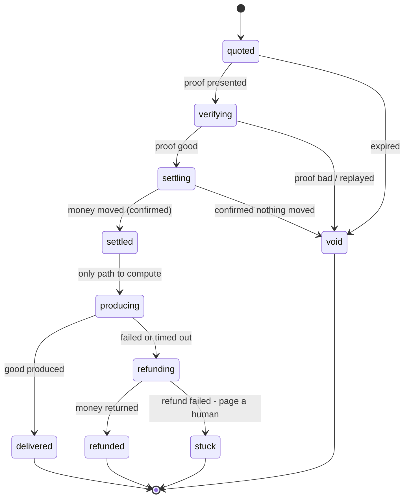

# Latch

**A settlement-safe gate for paid HTTP.** One promise, enforced:

> A caller is charged **if and only if** it received the good — or was refunded.

x402 is finished infrastructure. Cloudflare and AWS ship it at the edge, the
Linux Foundation runs the standard, and Visa, Mastercard, Stripe, Google and
Coinbase are members. Nobody needs another paywall.

What is *not* finished is the join between "the money moved" and "the customer
was served". Those are two different systems, and every gap between them is
either theft or free goods. Published research on x402 found that **every
evaluated facilitator violated at least one security rule**, and that **all
seven official reference server SDKs lack rollback for post-verification side
effects**. This is a small, hard library for exactly that seam.

---

## The problem in one picture

A paid endpoint does two things that cannot be made atomic: it moves money on a
payment network, and it produces something using its own compute. Whichever you
do first, a crash in the middle leaves a wrong answer.

```
produce, then charge   ->  crash between them  ->  free goods
charge, then produce   ->  crash between them  ->  the caller paid for nothing
```

The second is the right order — but only if the "paid for nothing" case is
recoverable. That is the entire design.

## The method

**1. Journal before you act.** Every state transition is written durably
*before* the side effect it authorises. A crash therefore always leaves a
record of what was about to happen, which is what makes recovery possible at
all.

**2. Never produce before settlement is committed.** `settled` is the only state
that can reach `producing`. This is checked by a test, not by convention.

**3. Never trust a negative answer from the payment network.** A settle call can
move the money and still report failure — a dropped response, a timeout after
broadcast. On any non-success the gate asks `statusOf(idempotencyKey)` and
believes *that*. A facilitator without a status oracle cannot be made safe.

**4. Every committed step has a compensating step.** If production fails after
settlement, the money goes back. If the refund also fails, the invoice becomes
`stuck` and an operator is paged — loudly, never silently kept.

**5. Exactly-once, by derived key.** The idempotency key is a hash of
(invoice, payer, amount, request). The same logical request always produces the
same key, so retries return the original result; any change to the purchase
produces a different key and is a different purchase.

**6. Tamper-evident receipts.** Each receipt is signed and commits to the hash
of the previous one, so neither party can rewrite history.

## States



Each terminal state has a defined money position, and the test suite asserts it
every single time:

| State | Money | Good |
|---|---|---|
| `void` | nothing moved | not delivered |
| `delivered` | charged exactly once | delivered |
| `refunded` | net zero | not delivered |
| `stuck` | held, flagged | not delivered |

## Try it

```bash
npm run demo          # a narrated walkthrough in the terminal
npm test              # 52 tests: crash injection, attacks, crypto vectors
npm run build:console # rebuild the visual console at web/latch-console.html
```

Nothing above needs a network, a database, or an API key.

## Usage

```ts
import { Latch, memoryJournal, hmacSigner } from "latch402";

const gate = new Latch<{ prompt: string }, { answer: string }>(
  { payTo: process.env.PAY_TO!, produceTimeoutMs: 12_000 },
  {
    journal: memoryJournal(),      // swap for SQL in production
    facilitator: myFacilitator,    // Coinbase, Stripe, your own rail
    signer: hmacSigner(process.env.RECEIPT_SECRET!),
    producer: {
      async produce(req, ctx) {
        // Runs only after the money is durably settled.
        // ctx gives you a budget, a deadline and an AbortSignal.
        return { answer: await callModel(req.prompt, { signal: ctx.signal }) };
      },
    },
  },
);
```

An HTTP route is then just two branches:

```ts
export async function POST(request: Request) {
  const body = await request.json();
  const payer = request.headers.get("x-agent-id");
  const proof = request.headers.get("payment-signature");

  if (!proof) {
    const { payment } = await gate.quote({
      payer, sku: body.sku, amountMicros: priceOf(body.sku), request: body,
    });
    return Response.json(payment, { status: 402 });
  }

  try {
    const { result, receipt } = await gate.redeem({
      invoiceId: JSON.parse(proof).invoiceId, payer, proof, request: body,
    });
    return Response.json(result, {
      headers: { "x-payment-response": JSON.stringify(receipt) },
    });
  } catch (err) {
    if (isLatchError(err)) {
      return Response.json({ error: err.message, code: err.code },
        { status: httpStatusFor(err.code) });
    }
    throw err;
  }
}
```

Run `gate.sweep()` on a timer. That is what finishes invoices whose caller
never came back.

## What is proven

`npm test` — 46 tests, no network, no database.

- **Crash injection at every journal write on the happy path**, both after the
  write became durable and before it did. Nine crash points, each restarted and
  recovered, each checked for money soundness. The important one is *"settlement
  succeeded and the process died before recording it"* — the case that loses
  money permanently in a naive implementation.
- **The published attack classes**: free shopping, settlement divergence,
  proof replay, concurrent double-spend, cost drain.
- **Double-entry accounting** in the test facilitator, so every test asserts
  that no money was created or destroyed — not merely that a function returned
  `ok`.

## Ports you must implement for production

| Port | Notes |
|---|---|
| `Journal` | Durable, append-only, ordered per invoice. `append` needs compare-and-set on `seq`; `consumeNonce` needs a unique index. Translates directly to Postgres. |
| `Facilitator` | `settle`/`refund` **must** be idempotent on `idempotencyKey`, and `statusOf` **must** be honest. Without a status oracle, crash recovery is guesswork. |
| `Producer` | Should respect `ctx.signal` and `ctx.budgetMicros`. Throwing is safe — it refunds. |

`memoryJournal()` is the reference implementation and the contract the SQL one
must meet. Its doc comment carries the SQL translation.

## Honest limits

- The in-memory journal is for tests and local development only.
- Receipts use HMAC, so a buyer needs the shared secret to verify. Swap
  `hmacSigner` for an asymmetric signer if third parties must verify alone.
- `stuck` invoices need a human. That is a feature, but it means you need an
  alert on them.
- Request bodies are persisted so recovery can replay them. Encrypt them at
  rest and purge them at terminal state.
- This handles the seller's side of the seam. The buyer's side — spend policy,
  budget ceilings, an audit trail of what your agents bought — is the mirror
  image and is not built here.
