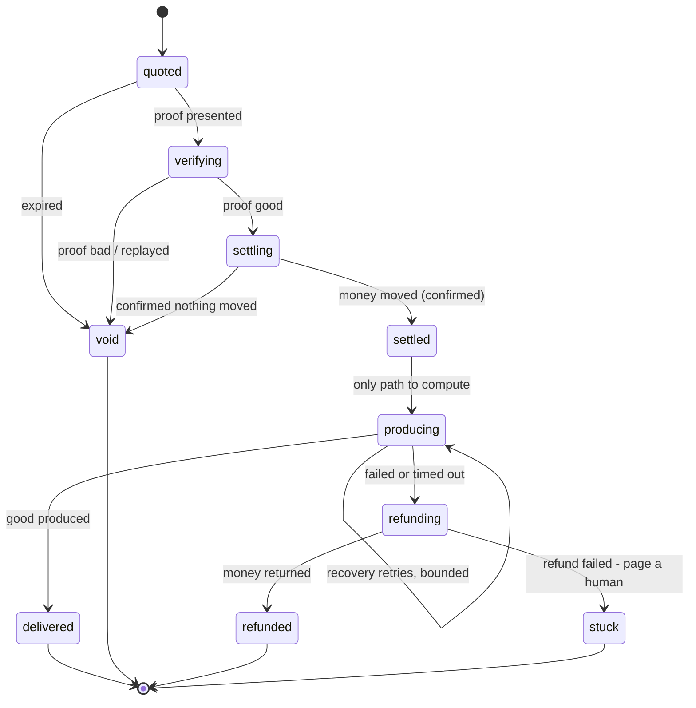

# Latch

**A settlement-safe gate for paid HTTP.** One promise, enforced:

> A caller is charged **if and only if** it received the good — or was refunded.

x402 is finished infrastructure. Cloudflare and AWS ship it at the edge, the
Linux Foundation runs the standard, and Visa, Mastercard, Stripe, Google and
Coinbase are members. Nobody needs another paywall.

What is *not* finished is the join between "the money moved" and "the customer
was served". Those are two different systems, and every gap between them is
either theft or free goods.

Published security research on x402 ([arXiv:2607.19545](https://arxiv.org/abs/2607.19545))
reports that every facilitator it evaluated violated at least one of its eight
security rules, and that all seven official reference server SDKs it examined
lack rollback for post-verification side effects. Those findings are that
paper's, not independent testing by this project. This is a small, hard library
for exactly that seam.

---

## The problem in one picture

A paid endpoint does two things that cannot be made atomic: it moves money on a
payment network, and it produces something using its own compute. Whichever you
do first, a crash in the middle leaves a wrong answer.

```
produce, then charge   ->  crash between them  ->  free goods
charge, then produce   ->  crash between them  ->  the caller paid for nothing
```

The second is the right order — but only if the "paid for nothing" case is
recoverable. That is the entire design.

## The method

**1. Journal before you act.** Every state transition is written durably
*before* the side effect it authorises. A crash therefore always leaves a
record of what was about to happen, which is what makes recovery possible at
all.

**2. Never produce before settlement is committed.** Only `settled` — or
`producing` itself, when recovery resumes a crashed attempt — can reach
`producing`. Both are post-charge states, so no path reaches compute before the
money moved. This is checked by a test, not by convention.

**3. Never trust a negative answer from the payment network.** A settle call can
move the money and still report failure — a dropped response, a timeout after
broadcast. On any non-success the gate asks `statusOf(idempotencyKey)` and
believes *that*. A facilitator without a status oracle cannot be made safe.

**4. Every committed step has a compensating step.** If production fails after
settlement, the money goes back. If the refund also fails, the invoice becomes
`stuck` and an operator is paged — loudly, never silently kept.

**5. Exactly-once, by derived key.** The idempotency key is a hash of
(invoice, payer, amount, request). The same logical request always produces the
same key, so retries return the original result; any change to the purchase
produces a different key and is a different purchase.

**6. Tamper-evident receipts.** Each receipt is signed and commits to the hash
of the previous one, so neither party can rewrite history.

## States



Each terminal state has a defined money position, and the test suite asserts it
every single time:

| State | Money | Good |
|---|---|---|
| `void` | nothing moved | not delivered |
| `delivered` | charged exactly once | delivered |
| `refunded` | net zero | not delivered |
| `stuck` | held, flagged | not delivered |

## Try it

```bash
npm run demo          # a narrated walkthrough in the terminal
npm test              # 75 tests: crash injection, attacks, crypto vectors, Postgres
npm run build:console # rebuild the visual console at web/latch-console.html
```

Nothing above needs a network, a server, or an API key.

## Usage

```ts
import { Latch, memoryJournal, hmacSigner } from "latch402";

const gate = new Latch<{ prompt: string }, { answer: string }>(
  { payTo: process.env.PAY_TO!, produceTimeoutMs: 12_000 },
  {
    journal: memoryJournal(),      // swap for SQL in production
    facilitator: myFacilitator,    // Coinbase, Stripe, your own rail
    signer: hmacSigner(process.env.RECEIPT_SECRET!),
    producer: {
      async produce(req, ctx) {
        // Runs only after the money is durably settled.
        // ctx gives you a budget, a deadline and an AbortSignal.
        return { answer: await callModel(req.prompt, { signal: ctx.signal }) };
      },
    },
  },
);
```

An HTTP route is then just two branches:

```ts
export async function POST(request: Request) {
  const body = await request.json();
  const payer = request.headers.get("x-agent-id");
  const proof = request.headers.get("payment-signature");

  if (!proof) {
    const { payment } = await gate.quote({
      payer, sku: body.sku, amountMicros: priceOf(body.sku), request: body,
    });
    return Response.json(payment, { status: 402 });
  }

  try {
    const { result, receipt } = await gate.redeem({
      invoiceId: JSON.parse(proof).invoiceId, payer, proof, request: body,
    });
    return Response.json(result, {
      headers: { "x-payment-response": JSON.stringify(receipt) },
    });
  } catch (err) {
    if (isLatchError(err)) {
      return Response.json({ error: err.message, code: err.code },
        { status: httpStatusFor(err.code) });
    }
    throw err;
  }
}
```

Run `gate.sweep()` on a timer. That is what finishes invoices whose caller
never came back.

## What is proven

`npm test` — 75 tests. No network, no server, no API keys: the Postgres suite
runs a real PostgreSQL 18 in-process via PGlite.

- **Crash injection at every journal write on the happy path**, both after the
  write became durable and before it did. Nine crash points, each restarted and
  recovered, each checked for money soundness. The important one is *"settlement
  succeeded and the process died before recording it"* — the case that loses
  money permanently in a naive implementation.
- **The published attack classes**: free shopping, settlement divergence,
  proof replay, concurrent double-spend, cost drain.
- **Bounded retry under repeated process death**, and a receipt that commits to
  the result the caller actually receives rather than a later re-production.
  Both are regressions for real defects found in audit.
- **Double-entry accounting** in the test facilitator, so every test asserts
  that no money was created or destroyed — not merely that a function returned
  `ok`.
- **The full gate over Postgres**, crash recovery included, proving the
  `Journal` port is a real abstraction rather than a comfortable fiction.

## Conformance kit

The port contracts used to be prose in doc comments, which meant nobody could
check an adapter against them. They are now executable — 17 rules for the
`Journal`, 20 for the `Facilitator` — and each one states what breaking it
costs in production:

```ts
import {
  runJournalConformance,
  runFacilitatorConformance,
  formatReport,
} from "latch402/conformance";

const report = await runJournalConformance({ create: () => myJournal() });
console.log(formatReport(report, "myJournal"));
```

```
  FAIL  F20  a settlement is refunded at most once, whatever the key
          total refunded to the payer under two different refund keys
          (expected 24000, got 48000)
          why it matters: Refund idempotency keyed only on the refund key lets
          two different keys refund the same settlement twice.
```

No test framework, no assertion library — it runs anywhere the library does,
and returns a report rather than throwing, so every violation surfaces at once.

**For a facilitator, your fixture issues the proofs.** The kit cannot fabricate
a signed authorisation for someone else's payment network, so you supply
`issue()` — for a real network, that is where a funded test wallet signs. Supply
`balanceOf()` too and the money-movement checks run; without it they are
reported as **skipped, never as passed**. The kit will not hand out a clean bill
of health it did not earn.

**What it cannot check.** Anything that needs a fault injected into the network:
a dropped response, a settle that lands after reporting failure, a settlement
still in flight when `statusOf` is asked. In particular it cannot verify that
`statusOf` only says "unknown" when nothing can still land later — that has to
come from the network's own guarantees. The gate-level crash and attack suites
cover those paths against the reference ledger.

**It earns its place.** Building it found real bugs in both kinds of adapter:

- `J16` — the Postgres journal reported a missing invoice as a *retryable*
  conflict, telling callers to retry forever something that could never succeed.
- `F10`/`F11` — the reference ledger's `settle` never looked at the proof. An
  authorisation issued for one invoice settled another.
- `F18`/`F19` — its `refund` never checked the reference, and paid out against
  a settlement that never happened.
- `F20` — one settlement could be refunded twice under different refund keys,
  paying the buyer back double.

The kit is self-checking: tests run it against deliberately broken adapters and
assert it reports exactly the known violation.

## Ports you must implement for production

| Port | Notes |
|---|---|
| `Journal` | Durable, append-only, ordered per invoice. **A Postgres adapter ships in the box** — see below. |
| `Facilitator` | `settle`/`refund` **must** be idempotent on `idempotencyKey`, and `statusOf` **must** be honest. Without a status oracle, crash recovery is guesswork. |
| `Producer` | Should respect `ctx.signal` and `ctx.budgetMicros`. Throwing is safe — it refunds. |

### Postgres

```ts
import { postgresJournal, migrate } from "latch402";

await migrate(sql);                    // run once at deploy, safe to re-run
const journal = postgresJournal(sql);  // hand it to the gate
```

`sql` is a small two-method shape (`query` and `transaction`) that `pg`,
`postgres.js` and PGlite each wrap in about ten lines — so the library keeps
zero runtime dependencies and you keep your own driver.

Three guarantees are enforced by the schema rather than by application code:
history is append-only, `append` compare-and-sets on `seq` so two workers can
never both advance one invoice, and a nonce is consumed in a single statement
so a replay cannot slip between a check and a write.

The adapter is tested against a real PostgreSQL 18 — the full gate, including
crash recovery, runs over it in `test/postgres-journal.test.ts`.

`memoryJournal()` remains the reference implementation for tests and local
development.

## Using this?

If you're integrating it, or you hit a failure mode it doesn't handle, open an
issue. Reports of cases that break it are more useful to this project than
stars are.

## Honest limits

- The in-memory journal is for tests and local development only.
- Receipts use HMAC, so a buyer needs the shared secret to verify. Swap
  `hmacSigner` for an asymmetric signer if third parties must verify alone.
- `stuck` invoices need a human. That is a feature, but it means you need an
  alert on them.
- Request bodies are persisted so recovery can replay them. Encrypt them at
  rest and purge them at terminal state.
- `quote()` is unbounded: every call opens an invoice row. Rate-limit it at
  your edge, or a flood of unpaid quotes bloats the journal.
- Ships as TypeScript source. Node 24 runs it directly (as do 22.18+ and any
  bundler); older runtimes need a transpile step.
- After a crash mid-settlement, recovery trusts `statusOf`. Its contract is
  strict — "unknown" must mean no settlement can still land later. A
  facilitator that cannot promise that must report "pending" instead; the
  sweep will keep asking.
- This handles the seller's side of the seam. The buyer's side — spend policy,
  budget ceilings, an audit trail of what your agents bought — is the mirror
  image and is not built here.
