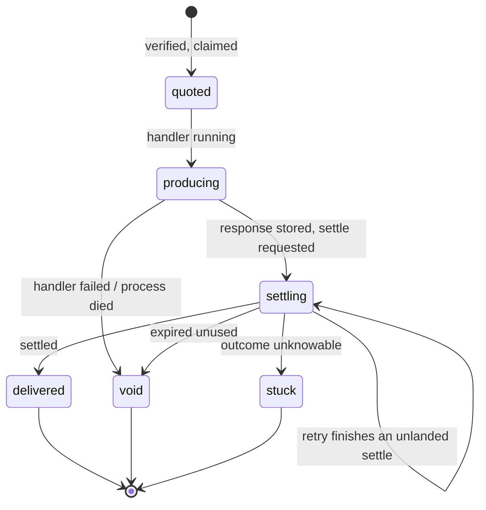
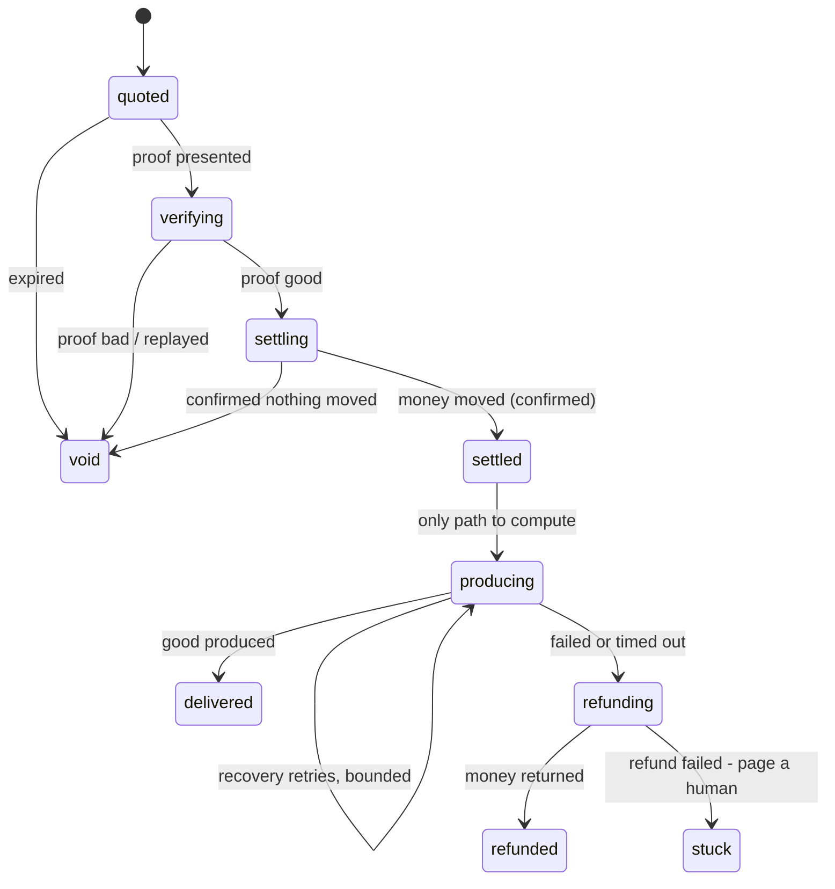

# Latch

**Settlement safety for x402.** One promise, enforced:

> A caller is charged **if and only if** it received the good.

x402 is finished infrastructure. Cloudflare and AWS ship it at the edge, the
Linux Foundation runs the standard, and Visa, Mastercard, Stripe, Google and
Coinbase are members. Nobody needs another paywall.

What is *not* finished is the join between "the money moved" and "the customer
was served". The official SDK keeps a payment's state in process memory, which
is enough until something goes wrong in between: a crash, a lost response, a
settle that reports failure after it broadcast, three copies of one payment
arriving at once. Latch makes that state durable, through the SDK's own
lifecycle hooks.

## Status

**0.3.1. Not yet used in production by anyone, including its author.**

- It plugs into the official SDK (`@x402/core` 2.30 and 2.31, tested with `@x402/hono`
  and `@x402/fetch`). The official client pays an official server through it.
- Every guarantee below is a test in this repository. The chain in those tests
  is a fake; the facilitator's failures are injected.
- **It has run live on Base Sepolia** (2026-11-13), through the public x402
  facilitator, with test USDC: `npm run example:testnet`. All five steps held,
  and the chain showed exactly three charges for three purchases — the lost
  reply, the duplicate copies and the crash recovery moved nothing extra.
- **It has not handled real money.** Nothing here has run on mainnet or in
  production.
- It covers one payment flow of one scheme. See [Limits](#limits).

If you try it and it breaks, that report is worth more to this project than a
star. [Open an issue.](https://github.com/Hitek-cel/latch402/issues)

The story behind it — what the official SDK does on its own, what broke, and
what changed upstream — is in [docs/writeup.md](docs/writeup.md).

## See it work

```bash
git clone https://github.com/Hitek-cel/latch402 && cd latch402 && npm install
npm run example
```

This starts a real HTTP server on `127.0.0.1`, protects it with Latch over an
in-process PostgreSQL, and pays it with the official x402 client. Then it
breaks things on purpose: a lost reply, three copies of one payment, and a
server that dies right after the money moved. The chain is simulated, so it
needs no network, keys or wallet.

`npm run example:testnet` runs the same five steps live on Base Sepolia,
through the public x402 facilitator, with free test USDC. It creates a
throwaway wallet in `.latch-demo/` (ignored by git) and tells you how to fund
it from Circle's faucet. It refuses any network but Base Sepolia and prints
every request it makes.

## Use it with the official SDK

```bash
npm install latch402 @x402/extensions
```

```ts
import { paymentMiddleware, x402ResourceServer } from "@x402/hono";
import { HTTPFacilitatorClient } from "@x402/core/server";
import { ExactEvmScheme } from "@x402/evm/exact/server";
import { migrate, postgresJournal } from "latch402";
import { eip3009Oracle, latchX402 } from "latch402/x402";
import { PAYMENT_IDENTIFIER, declarePaymentIdentifierExtension } from "@x402/extensions/payment-identifier";

await migrate(sql); // once at deploy; safe to re-run

const server = new x402ResourceServer(new HTTPFacilitatorClient({ url: FACILITATOR_URL }))
  .register("eip155:8453", new ExactEvmScheme());

const latch = latchX402(server, {
  journal: postgresJournal(sql),
  // Asks the token contract whether a payment landed. See "Never trust a failed settle".
  oracle: eip3009Oracle({ rpcUrls: { "eip155:8453": BASE_RPC_URL } }),
  onAlarm: (alarm) => console.error("latch", alarm),
});

app.use(
  paymentMiddleware(
    {
      "POST /answer": {
        accepts: { scheme: "exact", price: "$0.01", network: "eip155:8453", payTo: PAY_TO },
        // latch: collect a paid response again after a lost reply or a crash.
        // payment-identifier: a re-signed retry of one purchase is never charged twice.
        extensions: { ...latch.declare(), [PAYMENT_IDENTIFIER]: declarePaymentIdentifierExtension() },
      },
    },
    server,
  ),
);

// Finishes payments whose process died. Run it in every instance; it is safe to race.
setInterval(() => latch.sweep().catch(console.error), 30_000);
```

That is the whole integration. Your route handlers do not change. `sql` is a
two-method shape (`query`, `transaction`) that `pg`, `postgres.js` and PGlite
each wrap in about ten lines, so Latch has **no runtime dependencies** and you
keep your own driver. The hooks live on `x402ResourceServer`, so the Express
and Next adapters get the same behaviour; the tests here drive Hono.

## What changes

Each row is a test in `test/x402.test.ts`, run against the real SDK packages.
The middle column is what those same tests observe with Latch switched off.

| What happens | SDK alone | With Latch |
|---|---|---|
| Three copies of one payment arrive together | the handler runs three times | it runs once; the others get `402 payment_in_progress` |
| The settle moves money, then reports failure or times out | the caller is charged and gets a 402 | the chain is asked; the caller gets what it paid for |
| The process dies after the money moved | charged, nothing delivered, no record | the next process finds it; a retry returns the stored response |
| The process dies inside the handler | no record | the claim is closed; nothing was charged |
| The caller retries the same paid request after a lost reply | rejected, the payment is spent | the stored response comes back; no second charge |
| The caller signs again under the same `payment-identifier` | charged twice | answered from the store; the second signature never settles |
| The database is down | — | the sale is refused before anything is charged |

One test kills the server at **every journal write** of a payment, both just
before and just after the write became durable, then restarts and checks the
books: 48 cases, each asserting that the caller was charged exactly when the
good is collectable, and never twice.

## How it works on x402

The SDK's default flow is *verify → run the handler → settle → release the
response*. The handler runs before any money moves and its response is held
back until the settle lands. So nothing ever needs refunding; what needs
protecting is the record. Latch journals each step, write-ahead, and every
write is a compare-and-set:



**One claim per payment.** A payment is identified the way the chain
identifies it: by (payer, nonce). The claim is an atomic insert made after the
facilitator verifies the payment and before the handler runs, so of any number
of concurrent copies exactly one proceeds. Because the claim comes after
verification, junk payment headers cannot fill your database.

**Store the good before asking for the money.** The handler's response is
written to the journal before the settle is requested. Whatever happens to the
process next, a payment that lands has something to deliver.

**Never trust a failed settle.** A settle can broadcast and then time out, or
land and lose its response. On any failure Latch asks an oracle instead of
believing the facilitator. `eip3009Oracle` is one read-only `eth_call` to the
token contract: `authorizationState(payer, nonce)` is true exactly when that
authorization moved money. If it did, the caller gets the response. If it did
not, the payment stays `settling` until its own `validBefore` passes, because
until then it still could.

**Recovery never charges.** The sweep only learns what already happened. It
marks a payment `delivered` when the chain says it settled and `void` when it
can no longer land. Only the caller's own retry, re-verified by the
facilitator, can finish a settle that never went out.

**A stored response is not a free copy.** Everything in a settled EIP-3009
payment — payer, nonce, signature — is in the settlement transaction's
calldata, on a public chain. So "the same payment again" proves nothing. The
`latch` extension puts a fresh random token in each 402; the SDK's client
echoes it back with the payment; it travels only inside TLS and never reaches
the chain. A retry gets the stored response only by presenting it. A new
signature under an existing `payment-identifier` is verified by the facilitator
and must come from the same payer.

**`stuck` is deliberate.** A payment that expired with no way to learn whether
it landed is neither voided (which could hide a charge) nor marked delivered
(which could invent one). It raises an alarm for a human.

### Options

| Option | Default | |
|---|---|---|
| `journal` | — | Where state lives. `postgresJournal(sql)` in production. |
| `oracle` | none | Without one, an unclear settle can only be finished by the caller's retry, or ends `stuck`. |
| `signer` | none | Signs a hash-chained receipt for every delivered payment. |
| `staleMs` | 120 s | How long a claim may sit before its worker is presumed dead. Must exceed your slowest handler plus the facilitator timeout. |
| `replayWindowMs` | 10 min | How long a paid response stays collectable. `0` turns replay off. |
| `maxResponseBytes` | 256 KiB | Larger responses settle normally but are not stored for replay. |
| `schemes` | `["exact"]` | Schemes Latch journals. Others pass through untouched. |
| `onAlarm` | none | `settled_unrecorded`, `settlement_unresolved`, `stuck`, `journal_error`. Wire it to your pager. |

### `auth-capture`

The `auth-capture` scheme puts "charged only if delivered" on chain: money is
held in escrow, then captured, voided or refunded. What stays off chain is the
seller's record of each hold, and the store the SDK ships for it is in memory.
Lose it and the holds still exist, but the server no longer knows which it may
capture or must void.

```ts
import { AuthCaptureEvmScheme } from "@x402/evm/auth-capture/server";
import { migrateAuthCapture, postgresAuthorizedPaymentStorage } from "latch402/x402";

await migrateAuthCapture(sql);
new AuthCaptureEvmScheme({ storage: postgresAuthorizedPaymentStorage(sql) });
```

It is the SDK's `AuthorizedPaymentStorage` interface on Postgres, tested for
identical behaviour against the SDK's own store, for concurrent captures of one
hold, and for surviving a restart. It has not been exercised against a live
escrow contract.

## Limits

- **One flow.** Latch journals `exact` on the `authorization` flow (the
  default). A covered route configured to settle *before* its handler
  (`upfront`) is refused, uncharged: the SDK fires no hook when such a handler
  succeeds, so delivery cannot be observed there.
- **Handler side effects are yours.** The SDK runs your handler before the
  money moves. If the settle then fails, the response is withheld and nothing
  is charged, but whatever your handler already did has been done. Make it
  idempotent, or make the paid step the last one.
- **Replay returns JSON or HTML, with status 200.** That is what the SDK's
  replay path can carry. Other content types settle once and are recorded, but
  a retry gets `402 payment_already_used`.
- **Replay needs the token.** The route must declare `latch.declare()` and the
  client must echo server extensions. The official client does.
- **Declare `payment-identifier` too.** When a settle's outcome is still
  unknown, the caller gets the SDK's 402, which invites a client to sign a new
  payment rather than retry the same one. If the first payment then lands,
  that is two charges for one purchase — each matched by a good the caller can
  collect, but still two. With the `payment-identifier` extension declared on
  the route, the second signature is refused until the first is resolved.
  Without it, Latch cannot tell a re-signed purchase from a new one.
- **A request is method, path and query.** The body is not part of what a
  replay is matched against.
- **Stored responses stay in the journal.** They are your callers' data at
  rest. Encrypt the volume, and purge old rows on your own schedule; there is
  no purge API yet.
- **The oracle covers EIP-3009.** Permit2 and non-EVM payments have none yet,
  so an unclear settle there waits for the caller's retry or ends `stuck`.
  The oracle is only as honest as the RPC endpoint you give it.
- **Amounts must fit a safe integer** of atomic units. That is 9 billion USDC;
  an 18-decimal token overflows at 0.009 of a token and is refused.
- **Pinned to SDK behaviour.** Latch relies on the SDK passing one payload
  object through every hook of a request, and on its hook order. Both are
  pinned by tests against 2.30 and 2.31; a future SDK that changes them fails the
  build here, not your payments silently.

## What is proven

`npm test` — 130 tests. No network, no server, no API keys. The Postgres suites
run a real PostgreSQL in-process via PGlite.

- **The bridge against the real SDK** — `@x402/fetch` signs real EIP-3009
  payments, `@x402/hono` serves them, and no test calls a Latch hook directly.
  Crash injection at every journal write; replay, forgery and
  `payment-identifier` races; a journal that goes down before the claim, before
  the settle and after it; the same suite over Postgres.
- **The strict gate** (below) — crash injection at every write, the published
  attack classes, bounded retry under repeated process death, double-entry
  accounting in the test facilitator so no test can pass by creating money.
- **Both ports as executable contracts** — 22 rules for a `Journal`, 20 for a
  `Facilitator`.

```bash
npm test          # everything above
npm run test:dist # build to JavaScript and import it the way a consumer does
npm run example   # the bridge on a real server, offline (see "See it work")
npm run demo      # a narrated walkthrough of the strict gate
```

---

## The strict gate

Latch began as a gate of its own, and that gate is still here: `quote()` opens
a priced invoice, `redeem()` takes a payment proof and either delivers or
leaves the caller uncharged. It settles **before** it produces and refunds if
production fails, which is the order to use on a rail where you control both
steps.

**It does not speak the x402 wire format.** It issues its own invoice ids and
takes its own proof shape; a stock x402 client cannot pay it. For x402, use the
bridge above. The gate remains the reference for the state machine, the place
the port contracts are defined, and the right tool for a non-x402 rail.

```ts
import { Latch, memoryJournal, hmacSigner } from "latch402";

const gate = new Latch<{ prompt: string }, { answer: string }>(
  { payTo: process.env.PAY_TO!, produceTimeoutMs: 12_000 },
  {
    journal: memoryJournal(),      // swap for postgresJournal(sql) in production
    facilitator: myFacilitator,    // your rail, behind the Facilitator port
    signer: hmacSigner(process.env.RECEIPT_SECRET!),
    producer: {
      async produce(req, ctx) {
        // Runs only after the money is durably settled.
        return { answer: await callModel(req.prompt, { signal: ctx.signal }) };
      },
    },
  },
);
```

### Its rules

1. **Journal before you act.** Every transition is durable before the side
   effect it authorises.
2. **Never produce before settlement is committed.** Checked by a test, not by
   convention.
3. **Never trust a negative answer from the payment network.** On any
   non-success the gate asks `statusOf(idempotencyKey)` and believes that.
4. **Every committed step has a compensating step.** Production fails after
   settlement: the money goes back. The refund fails too: `stuck`, and a human
   is paged.
5. **Exactly-once, by derived key.** The idempotency key is a hash of
   (invoice, payer, amount, request).
6. **Tamper-evident receipts.** Signed, and each commits to the one before.



| State | Money | Good |
|---|---|---|
| `void` | nothing moved | not delivered |
| `delivered` | charged exactly once | delivered |
| `refunded` | net zero | not delivered |
| `stuck` | held, flagged | not delivered |
| `written_off` | never charged | delivered — *credit only* |

### Batched settlement

Some rails settle cheaply by batching: accepted now, final later. The gate
then has to choose between waiting for the batch and serving the caller on
credit. **Waiting is the default.** Serving early is opt-in and bounded:

```ts
new Latch({ payTo, credit: { maxOutstandingMicros: 5_000_000, maxPerPayerMicros: 500_000 } }, deps);
```

Credit relaxes only the seller's half of the promise — *delivered implies
paid* — and only up to a limit the seller chose. The caller's half is never
relaxed on any path. The limit check and the reservation are one atomic step;
the decision is journaled before any compute is spent; recovery never extends
new credit; and a test pins `credited` as the only state that reaches compute
before money is final. `gate.creditExposure()` reports what is outstanding.

This is the gate's own mechanism. It does not implement x402's
`batch-settlement` scheme.

## Conformance kit

The port contracts are executable, and each rule states what breaking it costs
in production:

```ts
import { runJournalConformance, runFacilitatorConformance, formatReport } from "latch402/conformance";

const report = await runJournalConformance({ create: async () => myJournal() });
console.log(formatReport(report, "myJournal"));
```

```
  FAIL  F20  a settlement is refunded at most once, whatever the key
          total refunded to the payer under two different refund keys
          (expected 24000, got 48000)
          why it matters: Refund idempotency keyed only on the refund key lets
          two different keys refund the same settlement twice.
```

No test framework and no assertion library; it returns a report rather than
throwing, so every violation surfaces at once. A check it cannot run is
reported as **skipped, never as passed**.

It cannot check anything that needs a fault injected into the network — a
dropped response, a settle that lands after reporting failure. Those paths are
covered by the crash and attack suites against the reference ledger.

Building it found real bugs: the Postgres journal reported a missing invoice
as a *retryable* conflict (`J16`); the reference ledger settled one invoice
with another's proof (`F10`/`F11`), refunded settlements that never happened
(`F18`/`F19`), and refunded one settlement twice under two keys (`F20`).

## Postgres

```ts
import { postgresJournal, migrate } from "latch402";

await migrate(sql);
const journal = postgresJournal(sql);
```

Three guarantees are enforced by the schema rather than by application code:
history is append-only, `append` compare-and-sets on `seq` so two workers can
never both advance one invoice, and an invoice is opened by a primary-key
insert so it can be opened once. The bridge and the gate can share one journal;
each sweeps only its own invoices.

## More limits

- The test suite runs PGlite, which executes transactions one at a time. It
  cannot demonstrate a multi-connection race, so the credit limit's row lock
  and the `auth-capture` store's advisory lock rest on standard Postgres
  behaviour, not on something this suite proves.
- The in-memory journal is for tests and local development only.
- Receipts use HMAC, so a buyer needs the shared secret to verify. Swap in an
  asymmetric signer if third parties must verify alone.
- `stuck` needs a human. That is a feature, and it means you need an alert.
- The strict gate's `quote()` is unbounded: every call opens an invoice row.
  Rate-limit it at your edge.
- Node 20 or later.
- This is the seller's side of the seam. The buyer's side — spend policy,
  budget ceilings, an audit trail of what your agents bought — is the mirror
  image and is not built here.

## License

Built by Azzam ([@Hitek-cel](https://github.com/Hitek-cel)). MIT. See [SECURITY.md](SECURITY.md) to report a vulnerability and
[CHANGELOG.md](CHANGELOG.md) for what changed.
